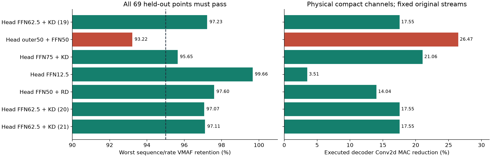
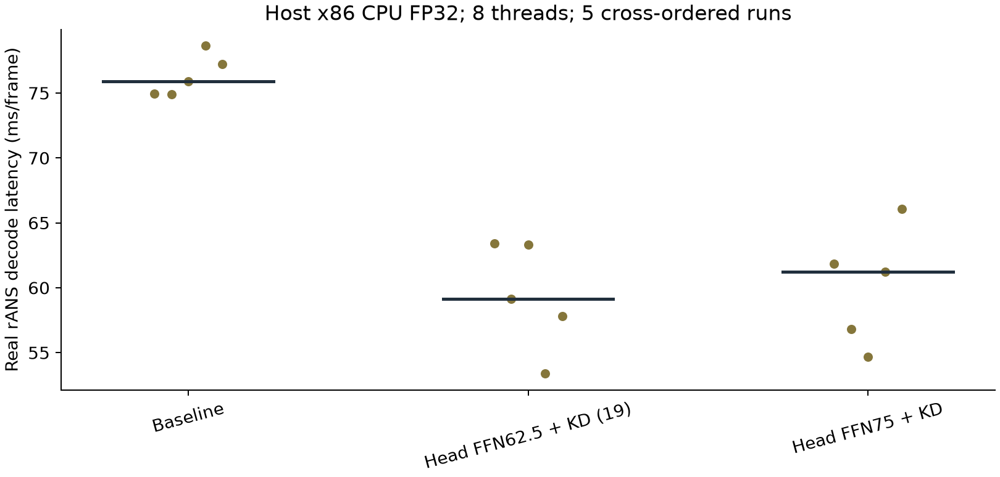

# MLVC-S 剪枝研究（2026-10-20）

在本次保留测试集上，重建头 FFN 物理通道剪枝可在**完全相同实际码流**下满足逐视频、逐码率 VMAF ≥ 原始 MLVC-S 的 95%。全部研究覆盖 165 组配置；这不是对所有剪枝方法的穷尽证明。

|方案|解码卷积 MAC 减少|整模型参数减少|69 点中最差 VMAF 保留率|验收|
|---|---:|---:|---:|---|
|推荐：head_ffn_taylor_p625_kd_seed20261019|17.55%|10.21%|97.23%|69/69 通过|
|最大通过：head_ffn_taylor_p750_kd_seed20261019|21.06%|12.25%|95.65%|69/69 通过|
|激进对照：head_outer50_ffn50_kd_seed20261019|26.47%|15.51%|93.22%|未通过|

两项推荐模型分别将重建头的门控/值 FFN 隐藏宽度从 384 缩到 144 和 96，外部特征宽度保持不变。推荐结构另有两个训练种子，均通过全部 69 点。



## 文件与下载

- [完整 HTML 报告](report.html)（下载后在浏览器打开）、[配置比较表](method-matrix.csv)、[逐视频结果](heldout-points.csv)、[结果摘要](results-summary.json)。
- [模型和完整证据 Release](https://github.com/Puiching-Memory/mlvc/releases/tag/mlvc-s-pruning-20261020)：完整包的 `.part-*` 分卷、`release-parts.json`、`assemble_release.py`、`public-bundle-receipt.json`、`SHA256SUMS`，以及两个可独立下载的推荐检查点。
- Git 分支只保存代码、报告、结果表、必要审计记录。完整包包含 32 个候选检查点、训练状态、844 个去重真实码流、逐帧 VMAF JSON、冻结熵表、原始模型和固定源码归档。
- [发布派生说明](publication-provenance.json)记录与原始交付包的关系。实验权重、实际码流、数据清单、测量 JSON 和实验源码逐字节保留；排除云账户/插件运维记录及进程日志。原始绝对实验路径用于证据追溯，可通过完整包的 `artifact-index.json` 映射。

## 验收与边界

基线为官方 MLVC-S PSNR v1，Microsoft 源码固定在 `64b10d4c0108106e66b7c54d6e5e470200a57abf`。16 段 Vimeo-90k 官方测试片段与 7 个完整、去重的 MOT17 FRCNN 视频共 5,428 帧；QP 12/32/52，共 69 个序列/码率点。优化和选型使用分离的 Vimeo/GOT10k 数据。MOT17-02 的原始模型曾用于协议实现 QA，没有用于候选训练、排序或检查点选择。公共源数据需自行按各数据集条款取得，包内不包含原始图像或原始解码 YUV。

输入最大 640×360（保持比例）；Vimeo 原生 448×256。VMAF 为逐序列均值之比，**不是每一帧都达到 95%**。所有容器头、帧长度和 rANS 载荷计入码率；模型权重不计入。候选直接解码原始编码器的同一个文件，69 点实际码率差均为零。

协议 `MLVCS_deployment_ltr64_idr1024_v2` 使用 LTR8/64 恢复、IDR1024、帧索引偏移 +1、零特征初始化及最近邻色度处理。研究容器 `MLVCPR02` 不声明官方 `.mlvc` 容器兼容。初版遗漏上述部署细节的测量已排除，见 `protocol-correction.json`。

H800 FP32 / PyTorch 2.8.0+cu128 / CUDA12.8，TF32 关闭。MAC 减少不等同于速度提升：GPU 约 4.58→4.59/4.57 ms/帧，没有明显加速；Xeon 8458P、8 线程 CPU 约 75.91→59.12/61.25 ms/帧（约 1.28×/1.24×）。完整 69 点质量仅在 H800 验证，CPU 仅计时及一次 Windows 7 帧兼容重放；尚无完整 CPU 质量复测、ARM/手机验证或其他分辨率保证。稀疏掩码是稠密内核对照，不是稀疏加速结果。



## 完整包核验与重放

先在任意空目录下载 Release 的全部分卷与回执（24 个分卷须全部下载；合并脚本兼容 Windows/Linux，逐卷及完整包均验证 SHA-256），并取得本目录的 `verify_export.py`：

```bash
gh release download mlvc-s-pruning-20261020 -R Puiching-Memory/mlvc \
  -p "mlvc-s-pruning-public-v2.tar.gz.part-*" -p release-parts.json \
  -p assemble_release.py -p public-bundle-receipt.json -p SHA256SUMS
sha256sum -c SHA256SUMS --ignore-missing
python assemble_release.py --directory .
python verify_export.py --archive mlvc-s-pruning-public-v2.tar.gz \
  --receipt public-bundle-receipt.json --destination verified \
  --verification manifest-verification.json
cd verified/mlvc-s-pruning-v2
python audit_delivered_evidence.py --bundle . --output evidence-audit-recheck.json
```

核验脚本只依赖 Python 3.12 标准库；核对完整压缩包、包内每个文件、模型哈希、69 个真实码流文件及 552 份逐帧指标文件。它不代替模型推理复测。

在 Linux、Python3.12、PyTorch2.8.0+cu128 的匹配 CUDA12.8 环境中（训练环境不使用 `requirements-report.txt`）：

```bash
python prepare_source.py
python -m pip install -r requirements-runtime.txt
python -m pip install ./vendor/mlvc/packages/msrtc_rans
bash build_vmaf.sh
python decode_stream.py \
  --stream streams/2d1523fb16920ed284f3c3b806df2122e541ecc5d98e978a2c02ce72f9ec443f.mlvcp \
  --checkpoint models/head_ffn_taylor_p750_kd_seed20261019.pt --structured \
  --entropy-tables entropy/encoder-tables.npz --output decoded.yuv
```

实际原始 CUDA 编码器的整数熵表必须保留；原生 CPU 和 CUDA 生成的表不同，重新生成会破坏跨设备兼容。文件和内容哈希见 `entropy/encoder-tables.json`。传统 FFN 检查点去掉 `--structured`；`--device cpu` 可供 CPU 兼容复测，但不是完整质量通过承诺。

重跑数据准备/训练时，按 `prepare_data.py`、`prepare_got_training.py`、`extend_test.py` 和数据清单重建公开数据。历史清单中的 Linux 路径指向原实验目录；在其他目录重跑应重新准备数据并生成当前路径清单，不能把原始清单当成已存在图像。历史测量与全新复跑输出应分别保存。训练缓存未打包；训练状态在 `training/`，当前 CLI 默认从原始权重重跑，不自动加载恢复状态。

## 源码与许可

实验脚本与该仓库一样按 MIT 许可发布；保留 [MLVC 许可](MLVC-LICENSE)。VMAF 模型及许可在完整包的 `vmaf/`。源数据使用仍受各数据集条款约束。[固定 MLVC 源码](https://github.com/microsoft/mlvc/tree/64b10d4c0108106e66b7c54d6e5e470200a57abf)、[VMAF3.0.0](https://github.com/Netflix/vmaf/tree/v3.0.0)。
